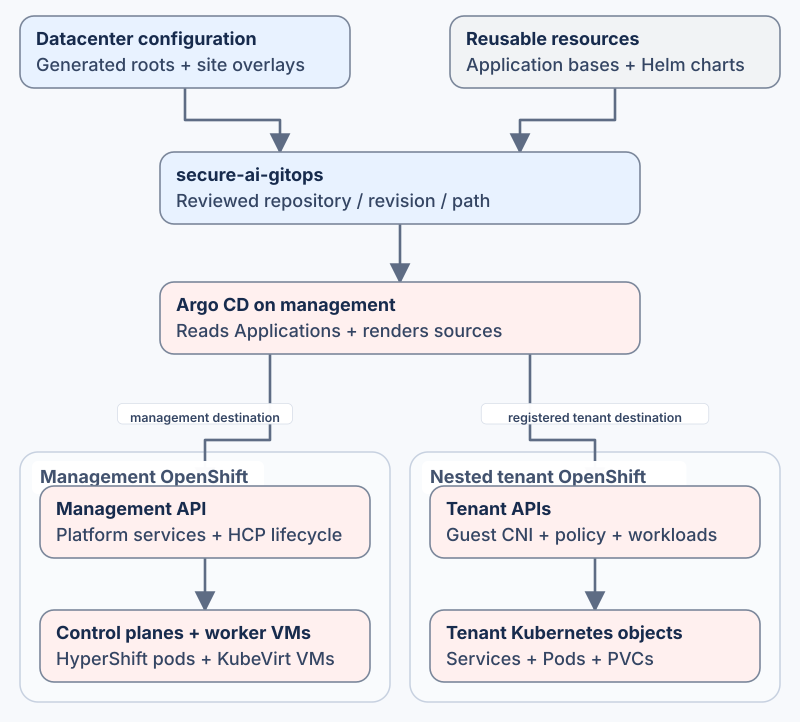

# Cisco Secure AI GitOps

Deliver the Kubernetes configuration of [Cisco Secure AI Datacenter](https://github.com/mahowlin/secure-ai-datacenter) through **Argo CD**. This repository holds cluster selections, application resources and Helm charts for networking, storage, observability and **nested Kubernetes**: tenant clusters with hosted control-plane pods and KubeVirt VM workers on management OpenShift.

## Start here

| What you want to do | Where to start |
|---|---|
| See what a cluster selects | [Cluster inventory](clusters/INVENTORY.md), then its [cluster root](clusters/) |
| Understand how configuration reaches the right API | [Reconciliation architecture](docs/ARCHITECTURE.md) |
| Import a new Datacenter composition or change site values | [Customization and generated-file ownership](docs/CUSTOMIZATION.md) |
| Add a workload or platform component | [Add an application](docs/mop/01-add-application.md) or [add an operator](docs/mop/02-add-operator.md) |
| Prepare credentials or diagnose sync failures | [Secret management](docs/SECRET_MANAGEMENT.md) and [troubleshooting](docs/mop/04-troubleshooting.md) |

## Follow one cluster's configuration

Start with [example-management/kustomization.yaml](clusters/example-management/kustomization.yaml). It selects shared core/Isovalent Applications through a [management type](clusters/_types/hcp-management/kustomization.yaml), plus the site's parent Applications.

Each Argo CD `Application` identifies **where its resources come from** (`spec.source`) and **which Kubernetes API receives them** (`spec.destination`). Follow those fields through an actual example:

| Component | Application selected by the root | Resource source |
|---|---|---|
| Management networking | [hcp-parent-network.yaml](clusters/example-management/hcp-parent-network.yaml) | [Network overlay](apps/hcp/management/parent-network/overlays/example-management/kustomization.yaml): host networking, attachments, DHCP and BGP |
| Persistent storage | [storage-portworx.yaml](clusters/example-management/storage-portworx.yaml) | [Portworx overlay](apps/storage/portworx-local/example-management/kustomization.yaml): [StorageCluster](apps/storage/portworx-local/example-management/storagecluster.yaml) and [shared StorageClass](apps/storage/portworx-local/example-management/default-storageclass.yaml) |
| Nested tenant lifecycle | [hcp-hosted-clusters.yaml](clusters/example-management/hcp-hosted-clusters.yaml) | [Lifecycle overlay](apps/hcp/management/hosted-cluster-lifecycle/overlays/example-management/kustomization.yaml): [HostedCluster](apps/hcp/management/hosted-cluster-lifecycle/overlays/example-management/example-multus-a/hostedcluster.yaml) and [NodePool](apps/hcp/management/hosted-cluster-lifecycle/overlays/example-management/example-multus-a/nodepool-workers.yaml) |
| Tenant networking | [Tenant networking Application](clusters/example-management/example-multus-a-tenant-networking.yaml) | Follow its source and tenant API destination; the [tenant root](clusters/example-multus-a/kustomization.yaml) shows the tenant's own selection |

Hosted control-plane pods and worker VM objects are management-cluster workloads. Applications targeting a registered tenant API configure that separate tenant Kubernetes cluster.

## Isovalent configuration

The cluster root selects these Applications and overlays. Their values determine which features are enabled for each cluster; the table maps configuration, not an assertion that every feature is active.

| Component | What is configured | Configuration |
|---|---|---|
| Cilium networking | CiliumConfig, address management and cluster networking | [Cilium Application](clusters/_base/tier2-isovalent/cilium.yaml) → [Cilium configuration chart](charts/cilium-config/values.yaml) |
| BGP and route import | Management peer sessions, advertisements, import policy and BFD | [Management BGP objects](apps/hcp/management/parent-network/overlays/example-management/cilium-bgp/) |
| Service exposure and policy | LoadBalancer address pools, L2 announcements, Gateway API, egress policy and DNS visibility | [Cilium chart templates](charts/cilium-config/templates/) and selected root values |
| Tenant networking | Guest-cluster CNI and routing configuration | [Tenant networking Application](clusters/example-management/example-multus-a-tenant-networking.yaml) → [tenant overlay](apps/hcp/tenant/tenant-datapath/overlays/example-multus-a/) |
| Isovalent Load Balancer | Router T1 and T2 node placement | [Router T1 Application](clusters/example-management/hcp-ilb-router-t1-placement.yaml), [T2 Application](clusters/example-management/hcp-ilb-t2-placement.yaml) and [placement overlays](apps/hcp/management/ilb-install/) |
| Hubble Timescape | Flow ingestion, ClickHouse storage, Kubernetes metadata and UI | [Timescape Application](clusters/_base/tier2-isovalent/hubble-timescape.yaml) and [ClickHouse operator](clusters/_base/tier2-isovalent/clickhouse-operator.yaml) |
| Flow export | Vector sources, transforms and delivery to Timescape; tenant S3 export | [Vector Application](clusters/_base/tier2-isovalent/vector-exporter.yaml) and [tenant exporter](clusters/example-management/example-multus-a-timescape-s3-exporter.yaml) |
| Tetragon | Operator subscription, runtime configuration and tracing policies | [Tetragon Application](clusters/_base/tier2-isovalent/tetragon.yaml) → [Tetragon resources](apps/tetragon/) |

## Where changes belong

| Location | Purpose |
|---|---|
| [clusters/](clusters/) | Cluster roots and Application selections; [_base](clusters/_base/) and [_types](clusters/_types/) compose shared selections |
| [apps/](apps/) | Kubernetes resources, reusable bases and site overlays |
| [charts/](charts/) | Helm templates and values used by selected Applications |
| [scripts/](scripts/) and [workflows](.github/workflows/) | Validation and configured site execution helpers |

Change Datacenter-owned site intent upstream, render it and import the generated files. Renderer markers and the artifact manifest identify generated ownership, including some shared selections. Maintain reusable resources and chart behavior here. The [customization guide](docs/CUSTOMIZATION.md) explains both cases.

## Bootstrap, validate and reconcile

1. **Prepare the root and child sources.** Review repository, revision, path, values and destination. [Local checks](AGENTS.md) cover Kustomize/Helm builds; build the selected children as well as the root.
2. **Supply private dependencies.** Follow [Secret management](docs/SECRET_MANAGEMENT.md) for trust, encrypted credentials and cluster registration. The lifecycle example references target-owned registry CA material and encrypted telemetry secrets; guest CNI also needs its entitled bootstrap process.
3. **Bootstrap Argo CD.** Use [Compute's post-install procedure](https://github.com/mahowlin/secure-ai-compute/blob/main/docs/POST_INSTALL.md) with the reviewed root. The standalone Compute starter needs a matching site-owned root.
4. **Inspect reconciliation.** Argo CD reports sync and health for each Application and destination; use [troubleshooting](docs/mop/04-troubleshooting.md) to follow failures into child resources.

Optional image-cache configuration follows [image delivery](https://github.com/mahowlin/secure-ai-datacenter/blob/main/docs/architectures/REGISTRY_CHAIN.md) and [cache lifecycle ordering](https://github.com/mahowlin/secure-ai-datacenter/blob/main/docs/architectures/HCP_CACHE_LIFECYCLE.md). For telemetry sources and destinations, see [observability architecture](docs/OBSERVABILITY_ARCHITECTURE.md).

## License and help

See [LICENSE](LICENSE), retained file notices and the shared [contribution/help guide](https://github.com/mahowlin/secure-ai-datacenter/blob/main/CONTRIBUTING.md). Isovalent software is obtained separately under entitlement.
