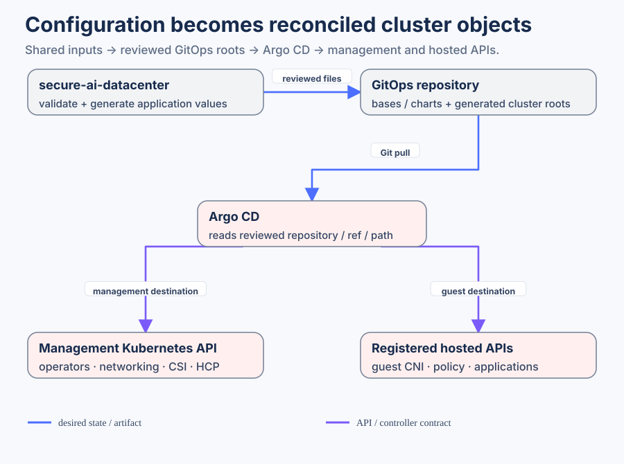

# Configuration and reconciliation architecture

This view expands the [repository overview](../README.md): which configuration source does Argo CD read, and which cluster API receives it?

Generated Applications specify exact source repository/ref/path, values, destination API and namespace. Reusable charts/base applications live in this repository. They can be consumed independently, but their source presence does not prove an installed controller or a healthy selected release.

Management applications target the management API; hosted applications target registered hosted APIs. Worker VMs and hosted control-plane pods are management-cluster workloads; a hosted API destination is a separate cluster identity. The generated parent-network, lifecycle, registry and storage overlays express their supported source model, with explicit cutover/staging guards retained.

The secret/CA boundary is private. Generated lifecycle Kustomizations may refer to target-owned registry CA material. Hosted observability secret overlays also need a private target and sealing key. Building the root Application list alone does not validate these child trees or prove API registration.

For release pins and portable input ownership see the sibling datacenter `platform-release.yaml`, cluster/default inputs and generated artifact manifest. For actual initial bootstrap use compute's existing post-install adapter. Mirroring/runner execution belongs to airgap, fabric execution to the optional fabric adapter. No deployment/push is implied by this diagram.

## Follow the selected management root

| Hop | Real source | Meaning |
|---|---|---|
| Cluster root | [clusters/example-management/kustomization.yaml](../clusters/example-management/kustomization.yaml) | Selects reusable management type plus site parent Applications |
| Reusable type | [clusters/_types/hcp-management/kustomization.yaml](../clusters/_types/hcp-management/kustomization.yaml) | Composes core and Isovalent base Application lists |
| Shared Applications | [core base](../clusters/_base/tier1-core/kustomization.yaml), [Isovalent base](../clusters/_base/tier2-isovalent/kustomization.yaml) | Declares sources/destinations for selected platform services |
| Parent to local overlay | [hcp-parent-network.yaml](../clusters/example-management/hcp-parent-network.yaml) → [network overlay](../apps/hcp/management/parent-network/overlays/example-management/kustomization.yaml) | Expands NMState, attachments, DHCP and BGP resources at the management API |
| Application to chart | [cilium.yaml](../clusters/_base/tier2-isovalent/cilium.yaml) → [cilium-config chart](../charts/cilium-config/Chart.yaml) | Root patches add site parameters; Helm renders Kubernetes objects |
| Application to storage resources | [storage-portworx.yaml](../clusters/example-management/storage-portworx.yaml) → [Portworx overlay](../apps/storage/portworx-local/example-management/kustomization.yaml) | Shared storage/controller resources consumed by workloads; activation is separately selected |

The bootstrap root Application reads `clusters/<cluster>` and creates these child Applications. Each child independently declares `spec.source` or `spec.sources`, its repo/ref/path or chart/values, `spec.destination` API/namespace and sync policy. Follow those fields to see what is reconciled; a directory's presence does not deploy it.

## Site changes versus reusable resources

Secure AI Datacenter owns canonical site identity, allocations, versions and selected features. Renderer-marked roots/overlays are generated output. Change those inputs, render and compare before import; do not patch the generated copy here. Unmarked reusable resources and maintained charts provide behavior shared across compositions. Some shared base/type selection files are also generated: follow the renderer marker and artifact manifest rather than classifying ownership from the directory name alone. A chart is rendered by Helm; an overlay composes local Kubernetes resources; both become objects only when the corresponding Application is selected and reconciled.

Hosted cluster Applications point to registered hosted APIs. Hosted control-plane pods and worker VM objects still run on management OpenShift. Their guest API destination is a separate Kubernetes cluster identity, not another namespace in management. Optional HCP, storage, telemetry and mirror stacks retain their real prerequisites and activation selection.

Private kubeconfigs/API registration, source access, sealing material and selected CA/Secret payloads are supplied through the site's runtime delivery. [Executable inspection](../agents/operations.md) builds a root and child separately; [secret custody](SECRET_MANAGEMENT.md) explains the private boundary.
