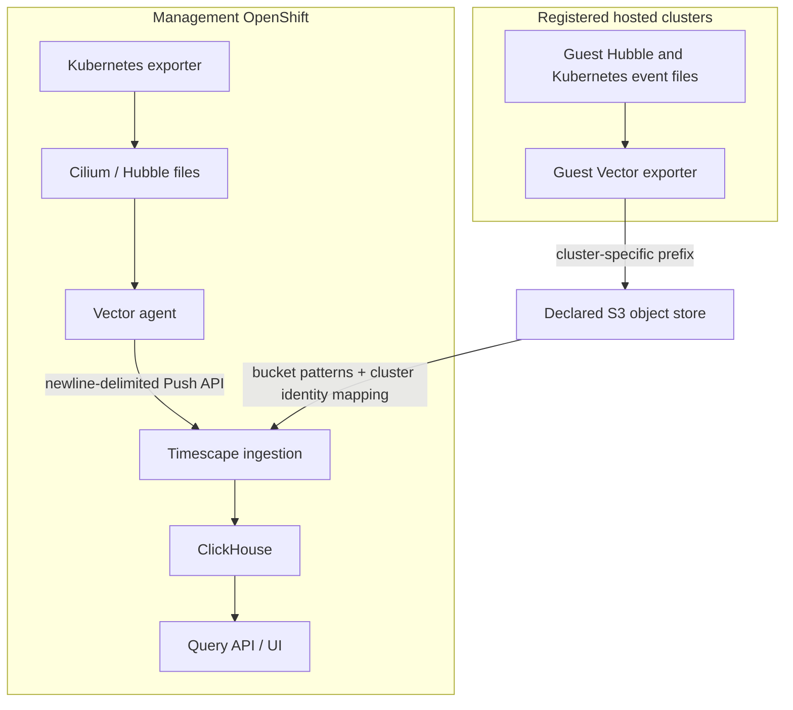

# Selected observability architecture

This reference describes the configured management and hosted-cluster data paths. It is not evidence of live collection, complete ingestion or a healthy UI. The selected Applications, Helm values, Secret references and source files determine the actual pipeline.

## Data sources and identity

| Source | Selected file / data | Consumer |
|---|---|---|
| Cilium / Hubble | `/var/run/cilium/hubble/hubble.log` | Network flow records read by Vector |
| Hubble connection export | `/var/run/cilium/hubble/connectionlog.log` | Connection records; this is the selected Connections source |
| Kubernetes exporter | `/var/run/cilium/hubble/k8s-events.log` | Kubernetes object/identity events read alongside flows |
| Application-model export | `/var/run/cilium/hubble/application-model.log` | Selected model events read alongside flows |

Tetragon has its own process/security event and metric configuration. This selected Vector/Timescape pipeline does not declare `tetragon.log` or `tetragon-connections.log` as its connection source. Do not infer process-execution or library-loading coverage in Timescape from the presence of Tetragon in the cluster. Check the actual selected source and documented release capability before making a wider product claim.

## Management ingestion

The generated [Vector Application](../clusters/_base/tier2-isovalent/vector-exporter.yaml) embeds its actual source file list, cluster identity enrichment and Push API sink values. Vector reads host files, preserves event data, adds the management cluster identity and posts newline-delimited events to the Timescape ingester. Its password comes from a runtime Secret reference; no credential value belongs in this documentation or browser-visible output.

The [Timescape Application](../clusters/_base/tier2-isovalent/hubble-timescape.yaml) and [bundled chart](../charts/hubble-timescape/values.yaml) define ingestion, ClickHouse, server and UI consumers. Secret key names and authentication-method values must match that exact chart contract. Source rendering, an image name or a root build is not evidence that this authentication or ingestion has succeeded.

## Hosted ingestion

Each enrolled hosted cluster has separate [exporter Applications](../apps/hcp/tenant/observability-scc/) and a Vector S3-export path generated from Datacenter observability defaults. These are distinct from the management Push API path. The cluster-specific object prefix and Timescape bucket/pattern/override-cluster mapping must agree, so events remain attributed to the correct guest cluster.

The current image-delivery default uses the declared preceding site registry; a hosted management-registry cache is an explicit alternative with its own producer and activation prerequisites. S3 endpoints, bucket, prefixes, images and runtime Secret references come from canonical inputs and generated values, not from a fixed endpoint in this guide.

## Metrics and optional consumers

OpenShift monitoring, Cilium/Hubble metrics, Tetragon metrics and GPU metrics are separate from the event-file pipeline above. Splunk/Intersight collectors require their own selected Applications, receivers, runtime credentials and endpoints; their existence as optional templates does not mean this composition enables them. The selected root and each child source define what is actually requested.

## Inspect the configured contract

[Agent operations](../agents/operations.md) owns local root/child rendering and inspection commands. Read the management Vector values, hosted exporter values, Timescape bucket patterns and referenced Secret metadata together. Keep all plaintext auth/kubeconfig/sealing material private. Runtime qualification must separately demonstrate collection, authenticated delivery, ingestion and a query/UI result with the correct source-cluster identity and freshness.
